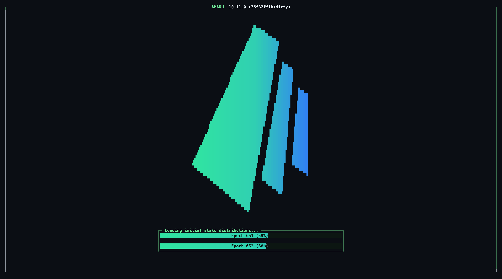
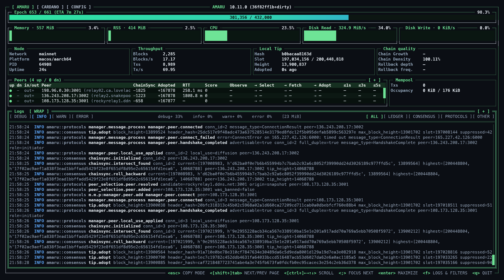
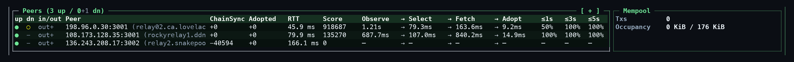
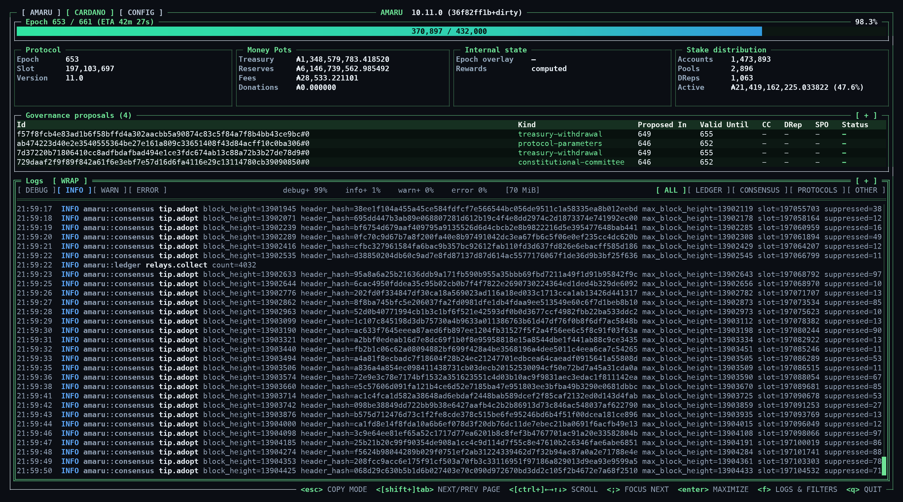
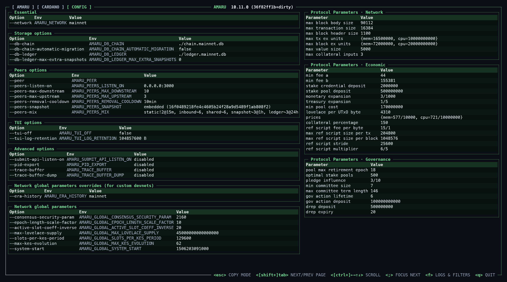

`amaru node run` opens an embedded terminal dashboard. It shows important information about your node, such as sync progress, resource usage, connected peers, and logs.

## Turning the TUI off

The dashboard starts by default when Amaru runs in an interactive terminal on Linux or macOS. It stays off when any of these hold:

- Flag `--tui-off` is set
- Environment variable `AMARU_TUI_OFF` is set to `true`
- JSON traces are enabled
- Environment variable `TERM` is set to `dumb`

When the TUI is disabled, logs go to standard output. That mode is recommended when running with systemd or Docker.

| Flag | Environment variable | Default | Purpose |
|---|---|---|---|
| `--tui-off` | `AMARU_TUI_OFF` | `false` | Disable the dashboard. |
| `--tui-log-retention` | `AMARU_TUI_LOG_RETENTION` | `100MiB` | Memory the log pane may use. See [Log retention](#log-retention). |
| | `AMARU_TUI_ALIASES` | none | Remap keys. See [Customizing keys](#customizing-keys). |

## Startup

Every time it starts, Amaru loads some initial stake distributions from disk before it can follow the chain. The dashboard appears when loading finishes.



## Layout

The page tabs `[Amaru] [Cardano] [Config]` sit in the top-left corner of the frame. Click a tab, or press `Tab`/`Shift+Tab` to cycle through the pages.

The center shows `AMARU` followed by the node version and commit. For example, `10.11.20260807 (493bffb)`.

The bottom-right corner lists the keys that work right now, written as `<key> ACTION`. The list changes with the mode. If you forget a key, look there.

The Amaru and Cardano pages stack three elements:

1. the epoch progress bar at the top;
2. the page's panels in the middle; and
3. the log pane at the bottom.

The Config page gives the whole screen to its tables.

On a very large terminal, the dashboard draws at most 65,536 characters. It keeps the full height and leaves the columns past that limit blank.

### Epoch bar

Once the node has a tip, a bar across the top tracks the current epoch in slots, for example `86,338 / 432,000`.

While Amaru catches up, the title reads `Epoch 307 / 308 (ETA 2m 56s)`. The first number is the epoch your local node has reached, and the second is the network's current epoch. The ETA is an estimate of how long the sync has left. Overall sync progress would appear on the right.

Once Amaru reaches the tip, the title drops to just the epoch number, and the percentage disappears.

### Focus and maximizing

One panel has focus at a time. The focused panel has a heavier border, and the arrow keys scroll within it. Press `;` to move focus to the next panel, or click on a specific panel to focus it.

Some panels can expand to the full screen. Press `Enter` on the focused panel, or click the `[+]` in its top-right corner to toggle full screen mode.

## Amaru page

This page is about the node process itself.


*Syncing on Mainnet*

### Resources

The top row has five gauges.

| Gauge | Shows | Percentage relative to |
|---|---|---|
| Memory | Memory allocated by the process | Total host memory |
| RSS | Resident set size, the part of that memory currently in RAM | Total host memory |
| CPU | Process CPU usage | 100% |
| Disk Read | Read rate in KiB/s or MiB/s | All reads on the host |
| Disk Write | Write rate | All writes on the host |

### Node, Throughput, Local Tip, Chain quality

| Card | Field | Meaning |
|---|---|---|
| Node | Network | The network the node joined, such as `mainnet`, `preprod` or `preview`. |
| | Platform | OS and architecture. |
| | PID | Process ID. |
| | Uptime | Time since the TUI started. |
| Throughput | Blocks, Txs | Blocks and transactions processed recently. |
| | Blocks/s, Tx/s | Smoothed processing rate. |
| Local Tip | Hash | First 12 characters of the tip block's hash. |
| | Slot | Slot of the local tip. Reads `slot / target` when there's a sync target. |
| | Height | Block height of the local tip. |
| | Adopted | Time since the node last adopted a block. |
| Chain quality | Chain Density | Observed block density as a share of the expected rate. |
| | Chain Growth | Not implemented yet. Always shows `-`. |
| | Rollback depth | Average length of recent rollbacks, in blocks. |
| | Rollback freq. | How often rollbacks happened lately. |

### Peers



The panel title counts connections, for example `Peers (8+2 up / 5+1 dn)`. The `up` side counts peers we use as upstreams. The `dn` side counts peers that use us as their upstream. In each pair, the first number is connections carrying block diffusion and the muted `+N` is connections kept only for maintenance.

Each row is one peer.

| Column | Meaning |
|---|---|
| up | How we use this peer. `●` means diffusion, `○` maintenance, `-` unused. |
| dn | How this peer uses us, with the same symbols. |
| in/out | `in` if the peer dialled us and `out` if we dialled it. A trailing `+` marks a full-duplex connection, which both sides may use at once. |
| Peer | Socket address. A peer resolved from a bootstrap host name or SRV record shows that name in parentheses. |
| ChainSync | Height of the latest header this peer sent, minus our adopted height. Positive means the peer is ahead. |
| Adopted | Height of the tip this peer advertises, minus our adopted height. |
| RTT | Currently measured round-trip time. |
| Score | Points for announcing new headers early. Faster upstreams score higher. |
| Observe | Average time from slot start until this peer delivered the header. Blank while catching up, since old blocks have no meaningful slot start. |
| Select | Average wait between accepting the header and requesting its body. |
| Fetch | Average time to download the block body from this peer. |
| Adopt | Average time this node took to validate and adopt the block. |
| ≤1s, ≤3s, ≤5s | Share of recent live blocks whose body arrived within 1, 3 or 5 seconds of slot start. |

Observe, Fetch and Adopt use the same stages as [openBlockPerf](https://developers.cardano.org/docs/operators/monitoring/monitoring-openblockperf/). Select is Amaru's own.

### Mempool

Txs counts pending transactions. Occupancy shows how much of the mempool's size budget they use, in KiB, for example `12 / 8,192 KiB`.

## Cardano page

This page shows ledger state as Amaru sees it.



| Card | Field | Meaning |
|---|---|---|
| Protocol | Epoch, Slot | Position of the local tip. |
| | Version | Protocol version in force. |
| Money Pots | Treasury, Reserves | Current balances in ADA. |
| | Fees | Fees collected so far this epoch. |
| | Donations | Treasury donations collected so far this epoch. |
| Internal state | Epoch overlay | `✓` when the node holds state for the epoch in progress. |
| | Rewards | `computed` once rewards for the next epoch boundary are ready, `not ready` before that. |
| Stake distribution | Accounts, Pools, DReps | Size of the latest stake snapshot. |
| | Active | Active stake, and its share of the maximum ADA supply. |

### Governance proposals

One row per proposal the ledger tracks.

| Column | Meaning |
|---|---|
| Id | Proposal ID, made of the transaction ID and index. |
| Kind | Action type, for example `treasury-withdrawal` or `protocol-parameters`. |
| Proposed In | Epoch the proposal was submitted. |
| Valid Until | Last epoch it can be ratified. |
| CC, DRep, SPO | Whether that body currently approves it. Shows `yes` or `no`, or `-` when the body has no say or there's no result yet. |
| Status | Where the proposal stands. |

## Config page



This page lists every option the node started with. Each row has the CLI flag, its `AMARU_*` environment variable and the value in effect. [Configuring the node](05-amaru-advanced-installation.md#3-configuring-the-node) explains what each option does.

Below the options are the protocol parameters and network-wide constants Amaru is using.

## Logs

The log pane appears on the Amaru and Cardano pages. New lines arrive at the bottom. Scroll up to read older ones, and scroll back down to follow new lines again.

### Level and component

The top row of the log pane has two sets of toggles; one to filter log levels, and one to filter component logs.

The toggles on the left are `debug`, `info`, `warn` and `error`. Each shows that level and everything more severe. The component toggles on the right are `all`, `ledger`, `consensus`, `protocols` and `other`.

### Filter, highlight and jump

Press `f` to open the log menu, then pick a command.

| Key | Action |
|---|---|
| `f` | Show only lines matching a regular expression. |
| `h` | Highlight matching lines and keep the rest visible. |
| `t` | Jump to a timestamp. Accepts `HH:MM`, `HH:MM:SS`, `YYYY-MM-DD` and `YYYY-MM-DD HH:MM[:SS]`. |
| `w` | Turn line wrapping on or off. |
| `Esc` | Close the menu. |

`f`, `h` and `t` open a prompt at the bottom of the screen. It validates as you type and shows an error for a bad regex or timestamp. `Enter` applies the input and `Esc` cancels. An empty submission clears the filter or highlight. `Ctrl+U` clears the line. `Ctrl+W` deletes the word before the cursor.

### Log title indicators

The log pane's title shows what's active.

| Indicator | Meaning |
|---|---|
| `[wrap]` | Line wrapping. Bright when on. Click it to toggle. |
| `scrub` | The scrollbar has focus, so arrow keys move through history in large steps. |
| `col N` | Scrolled sideways. Long lines start at column N. |
| `sel N` | N lines selected in copy mode. |
| `&pattern` | Active filter. |
| `/pattern` | Active highlight. |

### Log retention

The pane holds logs in memory up to the `--tui-log-retention` limit, `100MiB` by default. Older lines get thinned by level:

| Part of the buffer | Kept |
|---|---|
| Newest 70% | `debug` and above |
| Next 10% | `info` and above |
| Next 10% | `warn` and above |
| Oldest 10% | `error` only |

DEBUG lines vanishing as you scroll back is expected behaviour. The middle of the toggle row shows how full each part is, for example `debug+ 70%  info+ 10%  warn+ 10%  error 100%  [68.2 MiB]`. For complete logs, run with `--tui-off` and send output to a file or collector.

## Copying text

Double-click a value to copy it. A peer address copies as `ip:port`. To copy part of a row, drag across the characters you want. The dashboard holds still until you release the button.

## Copy mode and exporting logs

Press `Esc` to enter copy mode. The title changes to `COPY MODE`, and borders, scrollbars and separators disappear.

On the Amaru and Cardano pages, the TUI keeps the mouse so you can select log lines.

1. Click a line to start a selection.
2. Click another line to extend it to a time range. Each later click moves the closer end. Dragging works too.
3. Press `e` to write the visible lines in that range to a plain-text file in the working directory. With nothing selected, `e` writes every visible line. The footer shows the file name.

The export applies your current level, component and text filters.

On the Config page, the TUI hands the mouse back to your terminal, so normal text selection and copy work there.

`Esc` clears a selection. A second `Esc` leaves copy mode.

## Quitting

Press `q`, then confirm with `q` or `y`. Press `n` or `Esc` to cancel. The title shows `SHUTTING DOWN` until the node stops.

## Keyboard and mouse reference

<details><summary>Normal mode</summary>

| Key | Action |
|---|---|
| `Tab` / `Shift+Tab` | Next / previous page |
| `;` | Focus the next panel |
| `↑` `↓` | Scroll the focused panel one line |
| `←` `→` | Scroll log lines sideways when wrap is off |
| `Ctrl` + arrow | Scroll one scrollbar step |
| `PgUp` / `PgDn` | Scroll one screen |
| `Home` / `End` | Jump to the start or end. For logs, that's oldest or newest. |
| `Enter` | Maximize or restore the focused panel |
| `f` | Open the log menu |
| `Esc` | Enter copy mode |
| `q` | Quit, after confirmation |

</details>

<details><summary>Log menu, after <code>f</code></summary>

| Key | Action |
|---|---|
| `f` | Filter by regex |
| `h` | Highlight by regex |
| `t` | Jump to a time |
| `w` | Toggle wrap |
| `Esc` | Close the menu |

</details>

<details><summary>Copy mode</summary>

| Key | Action |
|---|---|
| Click / drag | Select log lines |
| `e` | Export the selected lines, or all visible lines, to a file |
| Arrows, `PgUp`, `PgDn`, `Home`, `End` | Scroll, as in normal mode |
| `f` | Open the log menu |
| `Esc` | Clear the selection, then leave copy mode |
| `q` | Quit, after confirmation |

</details>

<details><summary>Quit confirmation</summary>

| Key | Action |
|---|---|
| `q` or `y` | Shut down |
| `n` or `Esc` | Cancel |

</details>

<details><summary>Mouse</summary>

| Action | Effect |
|---|---|
| Click a page tab | Switch page |
| Click a panel | Focus it |
| Double-click a value | Copy it |
| Drag across a row | Copy those characters |
| Click `[+]` / `[-]` | Maximize or restore the panel |
| Click a level or component toggle | Change the log filter |
| Scroll wheel | Scroll the panel under the pointer |
| `Shift` + scroll wheel | Scroll log lines sideways |
| Drag the log scrollbar | Move through log history |

</details>

## Customizing keys

Some shells and multiplexers use the same keybinds the TUI uses. Remap keys in the TUI with `AMARU_TUI_ALIASES`, a comma-separated list of `key=alias` pairs. For example:

```sh
AMARU_TUI_ALIASES="esc=~,ctrl+up=k,ctrl+down=j" amaru node run
```

An alias replaces the original key. After `esc=~`, `Esc` does nothing and `~` takes over its job.

Write modifiers as `ctrl+` and `shift+`. Special keys are `esc`, `enter`, `tab`, `up`, `down`, `left`, `right`, `pageup`, `pagedown`, `home`, `end`, `backspace`, `delete`, `insert`, `space`, and `f1` to `f12`. Anything else is a single character.

These controls accept an alias: `esc`, `enter`, `tab`, `shift+tab`, `up`, `left`, `down`, `right` with and without `ctrl+`, `pageup`, `pagedown`, `home`, `end`, `;`, `e`, `f`, `h`, `n`, `q`, `t`, `w` and `y`.

If two controls map to the same key, Amaru refuses to start and names the collisions.

The footer shows your aliases. For page and scroll keys it shows `aliased` instead of listing each one.
